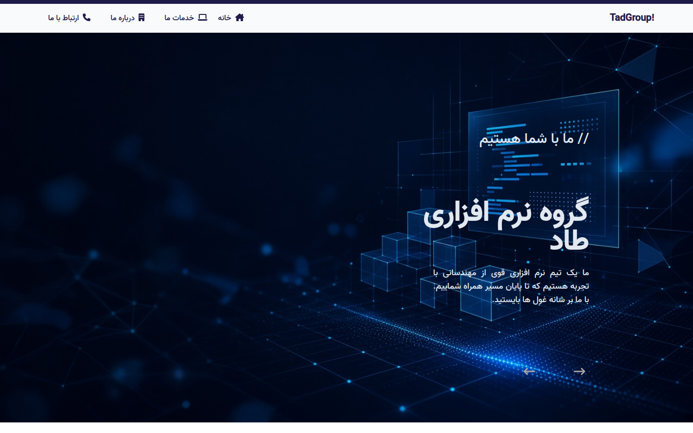

# TadGroup — Software Company Portfolio

<p align="center">
  
</p>

<p align="center">
  <strong>A modern, RTL-first company portfolio built with Vue 3, TypeScript, and Tailwind CSS</strong>
</p>

<p align="center">
  <a href="#features"></a>
  <a href="#tech-stack"></a>
  <a href="#tech-stack"></a>
  <a href="#tech-stack"></a>
  
</p>

---

## Overview

**TadGroup** is a full-featured marketing website for a fictional software company. It presents services, team, client feedback, and contact flows in a polished Persian (RTL) interface — originally built as an Internet Engineering midterm project at **Bu-Ali Sina University**.

The UI focuses on a strong first impression: a full-bleed hero slider, clear section hierarchy, and responsive layouts that work from mobile menus to wide desktop grids.

---

## Features

- **Hero image slider** with timed transitions and animated headline copy  
- **Multi-page routing** — Home, Services, About, and Contact  
- **RTL layout** tailored for Persian content (`dir="rtl"`)  
- **Responsive navigation** — desktop links + mobile hamburger menu  
- **Services & products** with card grids and Swiper carousels on small screens  
- **Statistics counters** highlighting experience, satisfaction, and projects  
- **Team & testimonials** sections for social proof  
- **Contact form** with client-side validation (VeeValidate)  
- **Utility-first styling** with Tailwind CSS and Font Awesome icons  

---

## Tech Stack

| Layer | Tools |
| --- | --- |
| Framework | Vue 3 (Composition + Options API where needed) |
| Language | TypeScript |
| Bundler | Vite 5 |
| Routing | Vue Router 4 |
| State | Pinia |
| Styling | Tailwind CSS 3, PostCSS, Autoprefixer |
| UI extras | Swiper, Font Awesome, vue3-autocounter |
| Forms | VeeValidate |
| Quality | ESLint, Prettier, `vue-tsc` |

---

## Pages

| Route | Description |
| --- | --- |
| `/` | Landing page — slider, services, brands, intro, stats, team, comments |
| `/services` | Service catalog with pricing-style cards |
| `/about` | Company story and offering details |
| `/contact` | Contact details and inquiry form |

---

## Getting Started

### Prerequisites

- **Node.js** 17+ (tested on Node 20)  
- **npm**

### Install

```bash
npm install
```

### Development

```bash
npm run dev
```

Open the local URL printed by Vite (usually `http://localhost:5173`).

#### Preview on a phone or tablet

```bash
npm run dev -- --host
```

Then open the **Network** URL from the terminal on your device (same Wi‑Fi).

### Production build

```bash
npm run build
npm run preview
```

### Lint & format

```bash
npm run lint
npm run format
```

---

## Project Structure

```text
src/
├── components/     # Reusable UI sections (Header, Slider, Products, …)
├── views/          # Route-level pages (Home, About, Services, Contact)
├── router/         # Vue Router configuration
├── stores/         # Pinia stores
├── assets/         # Static assets imported by the app
├── App.vue         # Root shell (RTL wrapper)
└── main.ts         # App bootstrap
public/             # Public static files (images, favicon)
docs/images/        # README demo assets
```

---

## Scripts

| Command | Purpose |
| --- | --- |
| `npm run dev` | Start Vite dev server with HMR |
| `npm run build` | Type-check and build for production |
| `npm run preview` | Serve the production build locally |
| `npm run type-check` | Run `vue-tsc` only |
| `npm run lint` | ESLint across the project |
| `npm run format` | Prettier on `src/` |

---

## Academic Context

This repository started as a coursework deliverable for the **Internet Engineering** course at Bu-Ali Sina University. It demonstrates practical front-end engineering: component architecture, client-side routing, responsive design, and a cohesive brand experience for a software-services company.

---

## Author

**Ali Zeinodin**

---

## License

This project is provided for educational and portfolio purposes. If you reuse parts of it, please credit the author.
